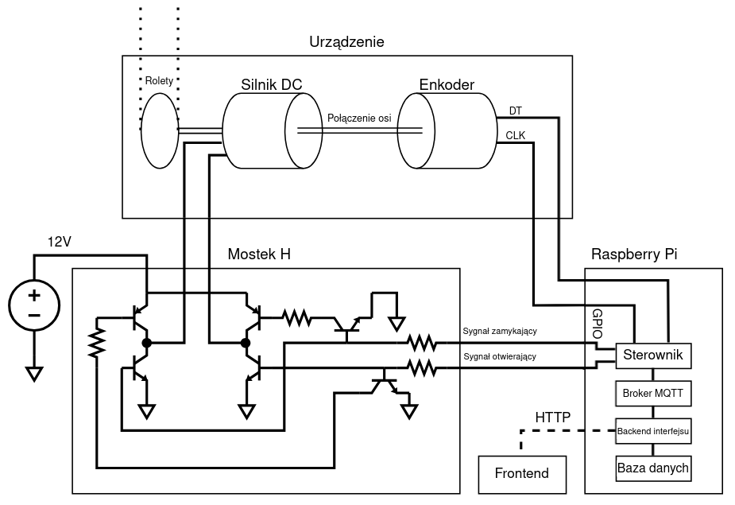
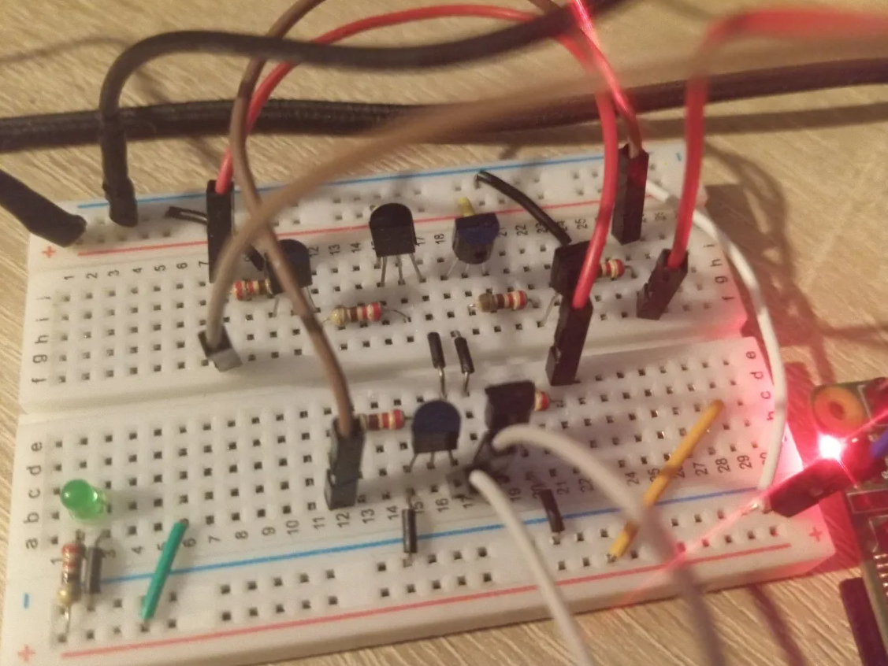
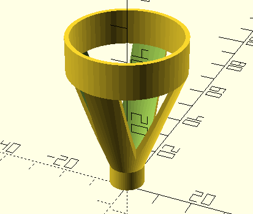
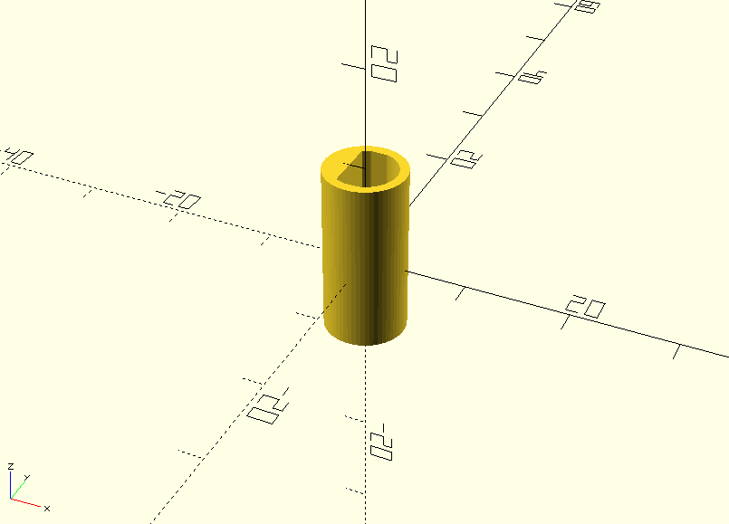
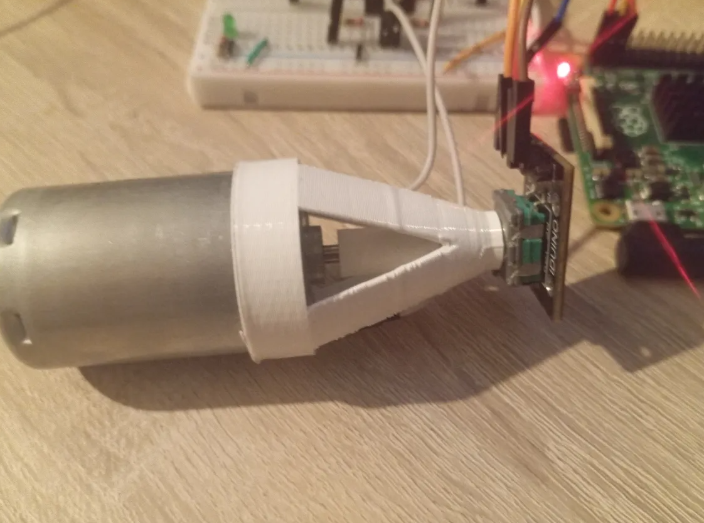
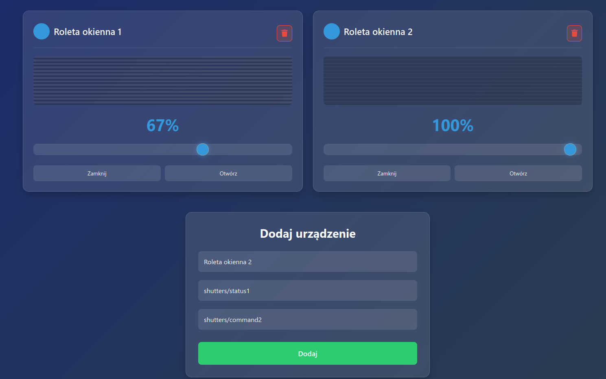
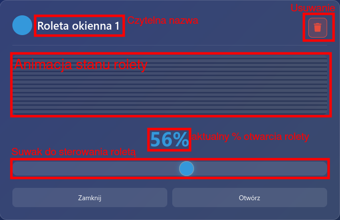

# Przemysłowy Internet Rzeczy

## Sterownik MQTT rolet okiennych z interfejsem sieciowym

## Spis treści

- [Cel i założenia projektu](#cel-i-założenia-projektu)
- [Realizacja](#realizacja)
  - [Urządzenie](#urządzenie)
    - [Mostek H](#mostek-h)
    - [Adapter silnika](#adapter-silnika)
  - [Oprogramowanie](#oprogramowanie)
    - [Broker](#broker)
    - [Sterownik](#sterownik)
  - [Interfejs sieciowy](#interfejs-sieciowy)
    - [Backend](#backend)
    - [Frontend](#frontend)
- [Wnioski i efekt końcowy](#wnioski-i-efekt-końcowy)

## Cel i założenia projektu

Celem projektu jest stworzenie urządzenia IIoT służącego do sterowania
roletami okiennymi poprzez protokół MQTT. Dodatkowo został utworzony interfejs
sieciowy pozwalający na sterowanie i przeglądanie wybranych rolet. Dzięki użyciu
protokołu MQTT, projekt bez problemu integruje się z istniejącymi systemami IoT
takimi jak np. Domoticz lub NodeRed.

Część fizyczna projektu, odpowiedzialna za ruch roletami, będzie składała się
z dwóch modułów: silnika prądu stałego i enkodera obrotowego. Rola silnika jest
oczywista, natomiast enkoder jest potrzebny do sprawdzania aktualnego stanu otwarcia rolet.
Silniki prądu stałego obracają się relatywnie szybko, dlatego do obsługi enkodera
potrzeby jest mikrokontroler obsługujący przerwania. Silnik jest podłączony do pinów
GPIO mikrokontrolera poprzez układ mostka H. Mostek H w tym projekcie służy do zmiany
kierunku obrotu silnika i wzmacnia napięcie z 3.3V GPIO na 12V.

Sterownik urządzenia będzie jednym klientem MQTT, rozgłaszającym aktualny stan rolet i
nasłuchującym ich pożądanego stanu. Do wymagań odnośnie mikrokontrolera dochodzi obsługa
protokołu MQTT (stos TCP, połączenie Wi-Fi lub Ethernet).

Interfejs sieciowy będzie drugim klientem MQTT. Będzie on nasłuchiwał
aktualnego stanu rolet i będzie wysyłał wiadomości sterujące.
Backend interfejsu będzie udostępniał API REST, z którego będzie korzystać frontend.

Szyfrowania połączenia MQTT nie ma w zakresie projektu, dlatego dla
podstawowego bezpieczeństwa zostanie użyty lokalnie zainstalowany broker
bez dostępu do internetu.



> _Schemat projektu_

## Realizacja

Do realizacji projektu zostały wykorzystane głównie elementy, które już miałem pod ręką.
Silnik krokowy prawdopodobnie lepiej by się nadawał do takiego projektu, ale posiadałem jedynie
sinik prądu stałego wyciągnięty ze starej drukarki. Enkoder rotacyjny również nie jest przeznaczony
do użytku z silnikiem, dlatego wymagane było zaprojektowanie i wydrukowanie odpowiedniego adaptera.

W praktyce sterownik, interfejs i broker mogą działać na osobnych urządzeniach.
Jednak do realizacji tego projektu zostało wykorzystane Raspberry PI 2B do
obsługi sterownika, interfejsu i brokera. Raspberry PI idealnie się nadaje do
hostowania lekkich aplikacji webowych lub lokalnego brokera MQTT. Dodatkowo
piny GPIO Raspberry PI wspierają przerwania, co jest niezbędne do obsługi enkodera.

### Urządzenie

Oprogramowanie steruje silnikiem za pomocą dwóch pinów GPIO.
Piny odpowiednio sterują obrotem silnika w lewo lub prawo poprzez układ mostka H.
Mostek H dodatkowo wzmacnia napięcie do 12V co jest potrzebne do obrotu użytego silnika.
Sam silnik jest połączony z enkoderem obrotowym, za pomocą wydrukowanego adaptera,
w taki sposób, że obrót osi silnika wywołuje obrót enkodera.
Enkoder jest podłączony do mikrokontrolera i obsługiwany przez odpowiednie przerwania.

#### Mostek H

Mostek H można nabyć w postaci gotowego układu na płytce, ale w tym projekcie
został on zrealizowany na tranzystorach BJT. Użyte tranzystory to S8550 (PNP) i S8050 (NPN).
Po stronie zasilania użyte zostały tranzystory PNP, a po stronie masy NPN.
Tranzystory NPN mogą być bezpośrednio sterowane za pomocą GPIO (przez odpowiedni rezystor).
W przypadku tranzystorów PNP pojawia się jednak problem -- stan wysoki GPIO Rasberry PI osiąga jedynie
3.3V, co nie jest wystarczające na wyłączenie tranzystora, pozostawiając go w stanie aktywnym.
Dodatkowo skutkuje to prądem wstecznym na pinach mikrokontrolera.
Rozwiązaniem była by konfiguracja open drain, ale Raspberry PI takiej nie posiada.
Problem ten został rozwiązany poprzez użycie dodatkowych tranzystorów NPN,
co dodatkowo neguje sygnał sterujący na tranzystorach PNP, co umożliwia
użycie tego samego pinu do obu tranzystorów danego kierunku obrotu.

Schemat mostka z pomocniczymi tranzystorami jest widoczny na Rysunku.



> _Mostek H na płytce stykowej_

#### Adapter silnika

Do połączenia enkodera obrotowego z silnikiem zostały zaprojektowane i wydrukowane dwa elementy.
Jeden łączy oś silnika z częścią obrotową enkodera, natomiast drugi łączy obudowy silnika i enkodera,
tak aby obrót osi nie obracał obudowy enkodera.

Modele zostały zaprojektowane w programie OpenSCAD, przygotowane do druku programem PrusaSlicer i
wydrukowane na drukarce 3D Creality Ender 3 filamentem PLA.

Modele programu OpenSCAD mają postać skryptów. Skrypt modelu koszyka wygląda następująco:

```c
translate([0,0, 30 + 8]) linear_extrude(10) difference(){
    circle(33 / 2); circle(30.5 / 2);
}

translate([0,0,2]) linear_extrude(6) difference(){
    circle(5); circle(3.3 + 0.2);
}

intersection() {
    difference() {
        translate([0,0,8]) cylinder(30, 5, 16.5);
        translate([0,0,7]) cylinder(32, 3.2, 15.8);
    }

    union(){
        cube([40,10, 100], center=true);
        cube([10,40, 100], center=true);
    }
}
```



> _Wizualizacja modelu koszyka trzymającego ze sobą enkoder i silnik_

Tak natomiast wygląda skrypt modelu adaptera osi:

```c
translate([0,0,-7]) linear_extrude(7) difference(){
    circle(4); circle(1.5);
}

linear_extrude(10) difference(){
    circle(4);
    intersection(){
        circle(3);
        translate([1.5,0,0]) square(6, center=true);
    }
}
```



> _Wizualizacja modelu adaptera osi obrotowych enkodera i silnika_



> _Zaprojektowane elementy łączące enkoder z silnikiem_

### Oprogramowanie

Całe oprogramowanie jest uruchomione na tym samym urządzeniu (Raspberry PI 2B).
W skład oprogramowania wchodzi broker MQTT mosquitto, sterownik silnika i interfejs sieciowy.
Broker mosquitto jest dostępny na repozytoriach APT, sterownik i backend interfejsu został napisany w języku Rust.
Frontend natomiast jest to zwykła strona HTML z prostym skryptem JavaScript.

#### Broker

Jako broker MQTT została wykorzystana lokalna instancja mosquitto.
Mosquitto może być zainstalowane poleceniem `apt install mosquitto`,
a następnie uruchomione poleceniem `systemctl enable --now mosquitto`.

Poprawność działania brokera można sprawdzić narzędziami
`mosquitto_sub` i `mosquitto_pub`. Wpierw subskrybujemy testowy
temat pierwszym poleceniem, a następnie wysyłamy wiadomość drugim
poleceniem i sprawdzamy czy dociera ona do subskrybenta.

```
kacper@raspberrypi:~ $ mosquitto_sub -t test &
[1] 751 ← proces uruchomiony w tle
kacper@raspberrypi:~ $ mosquitto_pub -t test -m "Witam serdecznie"
Witam serdecznie ← wiadomość od procesu mosquitto_sub
kacper@raspberrypi:~ $
```

#### Sterownik

Sterownik obsługujący silnik i enkoder został zaimplementowany w języku Rust.
Do obsługi pinów GPIO wykorzystana została biblioteka rppal.
Samo oprogramowanie sterownika składa się z kilku asynchronicznych zadań,
które przekazują między sobą dane za pomocą kanałów mpsc.

Przepływ danych wygląda następująco:

1. Klient MQTT odbiera żądaną pozycję rolety od brokera
2. Odpowiednia komenda jest przesyłana kanałem do pętli obsługującej komendy
3. Odpowiednie piny GPIO są ustawiane na stan wysoki tak, aby silnik przekręcił się w kierunku żądanej pozycji
4. Ruch silnika powoduje ruch enkodera (można też ręcznie ruszać roletami)
5. Przerwania enkodera aktualizują znaną pozycję rolety
6. Pętla klienta MQTT rozsyła nową znaną pozycję rolety do brokera

Dodatkowo istnieje możliwość wprowadzania komend rędznie do strumienia wejścia programu.

Inicjalizacja klienta MQTT wygląda następująco:

```rust
let mut mqttoptions = MqttOptions::new(CLIENT_ID, HOST, PORT);
mqttoptions.set_keep_alive(Duration::from_secs(5));
let (client, mut event_loop) = AsyncClient::new(mqttoptions, 10);
client.subscribe(COMMAND_TOPIC, QoS::AtLeastOnce).await?;
```

gdzie stałe `HOST` i `PORT` wskazują na lokalną instancję mosquitto.

Pętla odbierająca rządaną pozycję rolety wygląda nasępująco:

```rust
tokio::task::spawn(async move {
    while let Ok(notification) = event_loop.poll().await {
        if let Event::Incoming(packet) = notification {
            if let Packet::Publish(publish) = packet {
                let v: i32 = std::str::from_utf8(&publish.payload).parse();
                tx.send(MotorCommand::Go(v)).await;
            }
        }
    }
});
```

Zawartość komunikatów MQTT w tym projekcie są to zwykłe liczby całkowite w postaci łańcucha znaków.
Pętla przy odebraniu komunikatu zamienia łańcuch znaków na `i32` (oznakowana liczba całkowita 32-bitowa),
a następnie przesyła komendę sterującą silnikiem do kanału mpsc;

Obecnie system posiada jedynie dwie komendy: ustawianie rządanego stanu i kalibracja:

```rust
enum MotorCommand {
    Go(i32),
    Calibrate,
}
```

Pętla sterująca odbiera komunikaty i odpowiednio steruje silnikiem:

```rust
while let Some(command) = rx.recv().await {
    match command {
        MotorCommand::Go(desired_pos) => {
            let enc = get_encoder_count();
            if desired_pos > enc {
                motor.open();
                while desired_pos > get_encoder_count() {}
                motor.stop();
            } else if desired_pos < enc {
                motor.close();
                while desired_pos < get_encoder_count() {}
                motor.stop();
            }
        }
        MotorCommand::Calibrate => {
            reset_encoder_count();
            motor.open();
            thread::sleep(Duration::from_millis(100));
            motor.stop();
            if get_encoder_count() < 0 {
                motor.flip_polarity();
            }
        }
    }
}
```

Kręcenie silnika powoduje przerwania enkodera. Enkoder jest inicjowany w następujący sposób:

```rust
let mut clk = gpio.get(2)?.into_input();
let mut dt = gpio.get(3)?.into_input();
let debounce = None;
clk.set_async_interrupt(Trigger::Both, debounce, |event| {
    handle_encoder_interrupt(EncoderPin::CLK, event);
})?;
dt.set_async_interrupt(Trigger::Both, debounce, |event| {
    handle_encoder_interrupt(EncoderPin::DT, event);
})?;
```

gdzie funkcja `handle_encoder_interrupt` aktualizuje stan liczników enkodera:

```rust
static COUNTER: AtomicI32 = AtomicI32::new(0);
static CLK_STATE: AtomicBool = AtomicBool::new(false);
static DT_STATE: AtomicBool = AtomicBool::new(false);

pub fn handle_encoder_interrupt(pin: EncoderPin, event: Event) {
    let (new_clk, new_dt, increment) = match (
        pin,
        event.trigger,
        CLK_STATE.load(Ordering::Relaxed),
        DT_STATE.load(Ordering::Relaxed),
    ) {
        (_, Trigger::Disabled | Trigger::Both, _, _) => unreachable!(),
        (CLK, RisingEdge, false, false) => (true, false, 1),
        (DT, RisingEdge, true, false) => (true, true, 1),
        (CLK, FallingEdge, true, true) => (false, true, 1),
        (DT, FallingEdge, false, true) => (false, false, 1),

        (DT, RisingEdge, false, false) => (false, true, -1),
        (CLK, RisingEdge, false, true) => (true, true, -1),
        (DT, FallingEdge, true, true) => (true, false, -1),
        (CLK, FallingEdge, true, false) => (false, false, -1),
        (_, _, _clk, _dt) => (_clk, _dt, 0),
    };

    CLK_STATE.store(new_clk, Ordering::Relaxed);
    DT_STATE.store(new_dt, Ordering::Relaxed);

    COUNTER.fetch_add(increment, Ordering::Relaxed);
}
```

Przerwania enkodera są obsługiwane w osobnym wątku, dlatego zmienne trzymające stan enkodera muszą być atomowe.

### Interfejs sieciowy

Interfejs sieciowy dzieli się na frontend i backend. Sam frontend jest zwykłą statyczną stroną HTML
z dołączonym skryptem Javascript. Backend jest napisany w języku Rust (framework Axum) i udostępnia REST API pozwalające
na kontrolowanie i sprawdzanie stanu wielu urządzeń.

#### Backend

Backend odbiera i nadaje komunikaty MQTT i udostępnia interfejs REST ułatwiający sterowanie roletami
z witryny internetowej.

Funkcja główna backendu wygląda następująco:

```rust
#[tokio::main]
async fn main() -> anyhow::Result<()> {
    let state = AppState::new().await?;
    let app = Router::new()
        .route("/", get(root))
        .route("/style.css", get(css))
        .route("/script.js", get(script))
        .route("/shutters", get(get_shutters))
        .route("/shutters", put(set_shutter))
        .route("/shutters", post(add_shutter))
        .route("/shutters", delete(delete_shutter))
        .with_state(state);

    let addr = "0.0.0.0:3000";
    let listener = tokio::net::TcpListener::bind(addr).await?;
    println!("Listening on: http://{addr}");
    axum::serve(listener, app).await?;
    Ok(())
}
```

W funkcji głównej budowany jest router serwujący statyczny HTML, style CSS i skrypt JS.
Na ścieżce `/shutters` obsługiwane są obsługiwane cztery metody HTTP: GET, PUT, POST i DELETE, które
odpowiednio służą do sprawdzania, ustawiania, dodawania i usuwania rolet.

Ścieżki `/`, `/style.css` i `script.js` są obsługiwane przez następujące funkcje:

```rust
async fn root() -> impl IntoResponse {
    Html(include_str!("../static/index.html"))
}

async fn css() -> impl IntoResponse {
    (
        [(header::CONTENT_TYPE, "text/css")],
        include_str!("../static/style.css"),
    )
}

async fn script() -> impl IntoResponse {
    (
        [(header::CONTENT_TYPE, "application/javascript")],
        include_str!("../static/script.js"),
    )
}
```

Pliki tworzące frontend są dołączane do pliku wykonywalnego serwera podczas kompilacji za pomocą makra `include_str`.

Ścieżki `/shutters` wymagają bardziej skomplikowanej logiki, która zasięga do stanu aplikacji.
Stan aplikacji trzymany jest przez strukturę `AppState`:

```rust
#[derive(Clone)]
struct AppState {
    client: Arc<Mutex<AsyncClient>>,
    db: Arc<db::Database>,
}
```

Struktura ta składa się z klienta MQTT biblioteki `rumqttc` i bazy danych.

Użycie relacyjnej bazy danych, takiej jak np. PostgreSQL, do przechowywania kilku adresów MQTT
rolet okiennych jest przesadą, dlatego w tym projekcie została zastosowana wbudowana baza klucz-wartość
biblioteki sled. Alternatywami były RocksDB lub SQLite. Klucze jak i wartości w bazie danych sled są to zwykłe
ciągi bajtów, co wymaga pewnego systemu serializacji i deserializacji danych z bajtów.

Struktura `Database` wchodząca w skład struktury `AppState` abstrahuje bazę KV sled i udostępnia
metody odpowiednie dla systemu sterowania roletami okiennymi:

```rust
const BINCODE_CONFIG: Configuration<BigEndian> = bincode::config::standard().with_big_endian();

pub struct Database {
    kv: sled::Db,
}

impl Database {
    pub fn new() -> Self {
        let kv = sled::open("database").unwrap();
        Self { kv }
    }

    fn primary_key(id: u64) -> IVec {
        [*b"shutter_", id.to_be_bytes()].concat().into()
    }

    pub fn generate_id(&self) -> u64 {
        self.kv.generate_id().unwrap() as u64
    }

    pub fn insert_shutter(&self, shutter: Shutter) -> anyhow::Result<()> {
        let key = Self::primary_key(shutter.id);

        self.kv
            .insert(key, bincode::encode_to_vec(shutter, BINCODE_CONFIG)?)?;
        Ok(())
    }

    pub fn remove_shutter(&self, id: u64) -> anyhow::Result<()> {
        let key = Self::primary_key(id);
        self.kv.remove(key)?;
        Ok(())
    }

    pub fn get_shutter(&self, id: u64) -> anyhow::Result<Option<Shutter>> {
        let key = Self::primary_key(id);
        Ok(self
            .kv
            .get(key)?
            .map(|b| bincode::decode_from_slice(&b, BINCODE_CONFIG).unwrap())
            .map(|(s, _)| s))
    }

    pub fn get_shutter_by_status_topic(&self, topic: &str) -> Option<Shutter> {
        self.iter_shutters().find(|s| s.status_topic == topic)
    }

    pub fn iter_shutters(&self) -> impl Iterator<Item = Shutter> {
        self.kv
            .scan_prefix(b"shutter_")
            .filter_map(|r| Some(r.unwrap()))
            .map(|(_, v)| bincode::decode_from_slice(&v, BINCODE_CONFIG).unwrap())
            .map(|(s, _)| s)
    }
}
```

Posiadając dostęp do bazy danych można rozpocząć obsługę zapytań REST.
Zapytanie dodania nowej rolety składa się z czytelnej nazwy rolety i dwóch tematów MQTT:
jeden do otrzymywania stanu rolety i drugi do jego ustawiania. Rolecie przypisane jest unikatowe id i
temat czytania stanu rolety jest subskrybowany.

```rust
async fn add_shutter(
    State(app): State<AppState>,
    Json(payload): Json<AddShutterRequest>,
) -> impl IntoResponse {
    let id = app.db.generate_id();
    let shutter = Shutter {
        id,
        name: payload.name,
        command_topic: payload.command_topic,
        status_topic: payload.status_topic,
        position: 100,
    };

    let client = app.client.lock().await;
    client
        .subscribe(&shutter.status_topic, QoS::AtLeastOnce)
        .await
        .unwrap();

    app.db.insert_shutter(shutter).unwrap();
    StatusCode::OK
}
```

Zapytanie GET pobierania rolet jest mniej skomplikowane. Wszystkie rolety są pobierane z
wbudowanej bazy danych i zamienione na odpowiedź w formacie JSON:

```rust
async fn get_shutters(State(app): State<AppState>) -> impl IntoResponse {
    let response: Vec<_> = app.db.iter_shutters().collect();
    Json(response)
}
```

Zapytanie PUT, ustawiające stan rolety, nie modyfikuje zawartości bazy danych. Wysyła ona jedynie
komunikat MQTT na odpowiedni temat.

```rust
async fn set_shutter(
    State(app): State<AppState>,
    Json(payload): Json<ShutterState>,
) -> impl IntoResponse {
    let shutter = app.db.get_shutter(payload.id).unwrap().unwrap();
    let client = app.client.lock().await;
    client
        .publish(
            &shutter.command_topic,
            QoS::AtLeastOnce,
            false,
            payload.position.to_string().as_bytes(),
        ).await;
    StatusCode::OK
}
```

Ostatnim możliwym zapytaniem jest usuwanie rolety. Obsługa zapytania DELETE usuwa roletę z
wbudowanej bazy danych i kończy subskrypcję odpowiedniego tematu MQTT.

```rust
async fn delete_shutter(
    State(app): State<AppState>,
    Json(payload): Json<DeleteShutterRequest>,
) -> impl IntoResponse {
    let shutter = app.db.get_shutter(payload.id).unwrap().unwrap();
    let client = app.client.lock().await;
    client.unsubscribe(shutter.status_topic).await.unwrap();
    app.db.remove_shutter(payload.id).unwrap();
    StatusCode::OK
}
```

Ostatnim brakującym elementem backendu jest przyjmowanie komunikatów MQTT od
brokera i zapisywanie odebranego stanu rolet do bazy danych. Domyślny konstruktor
struktury `AppState` oprócz inicjalizacji klienta MQTT i bazy danych, uruchamia w tle
pętle przyjmującą komunikaty.

```rust
async fn new() -> anyhow::Result<Self> {
    let mut mqttoptions = MqttOptions::new(CLIENT_ID, HOST, PORT);
    mqttoptions.set_keep_alive(Duration::from_secs(5));

    let (client, mut event_loop) = AsyncClient::new(mqttoptions, 64);

    let kv = Arc::new(db::Database::new());
    {
        let kv = kv.clone();
        tokio::task::spawn(async move {
            println!("MQTT event loop starting...");
            while let Ok(notification) = event_loop.poll().await {
                if let Err(err) = handle_mqtt_notification(&kv, notification) {
                    eprintln!("Error handling MQTT notification: {}", err);
                }
            }
            println!("MQTT event loop shutting down...");
        });
    }

    for shutter in kv.iter_shutters() {
        client
            .subscribe(shutter.status_topic, QoS::AtLeastOnce)
            .await?;
    }

    Ok(Self {
        db: kv,
        client: Arc::new(Mutex::new(client)),
    })
}
```

Podczas inicjalizacji dodatkowo są subskrybowane odpowiednie tematy MQTT rolet pobranych z bazy danych.

Komunikaty MQTT trafiają do funkcji `handle_mqtt_notification`, gdzie odebrane dane są zapisane do bazy danych:

```rust
fn handle_mqtt_notification(kv: &Database, notification: Event) -> anyhow::Result<()> {
    if let Event::Incoming(packet) = notification {
        if let Packet::Publish(publish) = packet {
            let topic = publish.topic;
            let v: i32 = std::str::from_utf8(&publish.payload).parse();

            let mut shutter = kv.get_shutter_by_status_topic(&topic);
            shutter.position = v;
            kv.insert_shutter(shutter)?;
        }
    }
    Ok(())
}
```

#### Frontend

Frontend składa się z zaledwie 60 linijek HTML. Każda roleta jest dynamicznie
dodawana w postaci kafelka do dokumentu za pomocą skryptu. Pod kafelkami znajduje się
formularz służący do dodawania nowych rolet.



> _Widok frontendu z dwoma roletami_



> _Kafelek reprezentujący roletę w interfejsie_

Zmienna globalna `shutters` jest cyklicznie wypełniania danymi pobranymi z backendu, a następnie
wykorzystywana jest przy wypełnianiu strony kafelkami.

```js
window.onload = async function () {
  const res = await fetch("/shutters");
  shutters = await res.json();
  renderShutters();

  setInterval(async () => {
    const res = await fetch("/shutters");
    shutters = await res.json();
    for (const shutter of shutters) {
      await updateShutterPosition(shutter.id, shutter.position, false);
    }
  }, 100);
};
```

gdzie funkcja `renderShutters` wygląda następująco:

```js
function renderShutters() {
  const dashboard = document.getElementById("shutterDashboard");
  dashboard.innerHTML = "";

  shutters.forEach((shutter) => {
    const widget = document.createElement("div");
    widget.className = "shutter-widget";
    widget.innerHTML = `
    ...
   <div class="shutter-visual">
    <div class="shutter-lines" id="visual-${shutter.id}"></div>
   </div>
    ...
   <div class="percentage-display">${shutter.position}%</div>
    ...
   <div class="preset-buttons">
    <button onclick="updateShutterPosition(${shutter.id}, 0, true)">Zamknij</button>
    <button onclick="updateShutterPosition(${shutter.id}, 100, true)">Otwórz</button>
   </div>
    `;
    dashboard.appendChild(widget);
    updateShutterVisual(shutter.id, shutter.position);
  });
}
```

## Wnioski i efekt końcowy

Po połączeniu wszystkiego w jedną całość otrzymujemy działające urządzenie IoT wraz z interfejsem sieciowym.
Roletami można sterować poprzez interfejs, gdzie wyświetlany też jest ich aktualny stan.

Urządzenie jednak nie do końca nadaje się do praktycznego użytku.
Użyty silnik DC nie posiada wystarczającej siły, aby ruszać fizycznymi roletami.
Potrzebna by była pewnego rodzaju przekładania zmieniająca prędkość obrotową na siłę.

Kolejną wadą jest ręcznie zrobiony mostek H, którego tranzystory nie posiadają dostatecznej mocy,
aby sterować silnikiem przez dłuższy czas. To oczywiście można rozwiązać używając gotowego układu na płytce.

Ostatnią oczywistą wadą systemu jest brak zabezpieczeń na wszelkiego rodzaju awarii. Sterownik
daje moc silnikowi póki nie osiągnie on żądanej pozycji. W przypadku niepoprawnej kalibracji lub
zablokowania silnika, żądany stan nie będzie nigdy osiągnięty, co spowoduje spalenie układu.
Ten problem można złagodzić modyfikacją kodu sterownia lub podłączeniu do układu bezpiecznik.

Mimo tych wad tworzenie tego projektu dało mi cenne doświadczenie tworzenia urządzeń IIoT,
co z pewnością przyda mi się w przyszłości.
